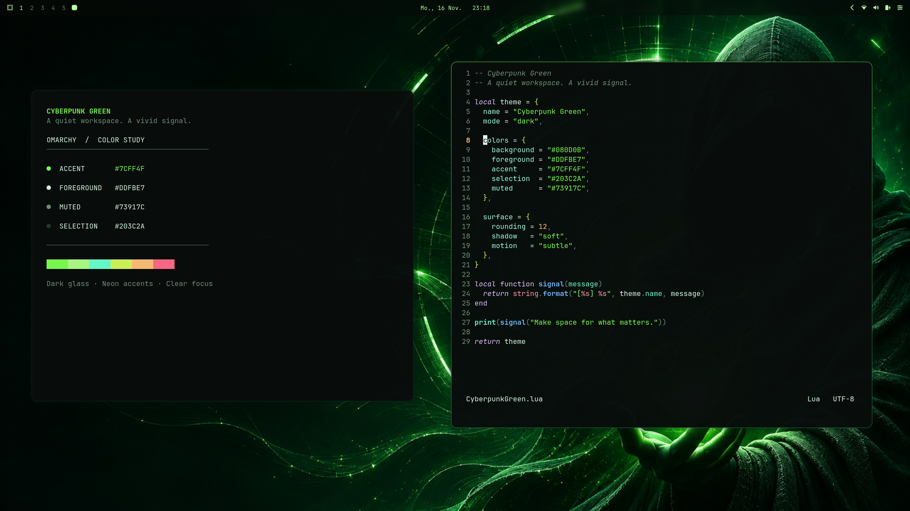

# Cyberpunk Green

A dark Omarchy theme with charcoal surfaces, electric green accents, mint text, and three cinematic emerald wallpapers. Distinct pink-red errors and blue, cyan, and purple syntax colors keep terminals and editors readable.



## Install

```sh
omarchy theme install https://github.com/anoshii-code/omarchy-cyberpunk-green-theme.git
```

Omarchy installs and applies the theme. You can select **Cyberpunk Green** later from the theme menu. Choose another included wallpaper through Omarchy's background picker.

## Palette

| Role | Color |
| --- | --- |
| Background | `#080D0B` |
| Foreground | `#DDFBE7` |
| Accent | `#7CFF4F` |
| Selection | `#203C2A` |
| Muted | `#73917C` |
| Error | `#FF6B88` |
| Syntax blue | `#70B7FF` |

The palette supplies all 16 ANSI terminal colors. Standard foreground text has 17.74:1 contrast against the opaque base background; the result on translucent surfaces also depends on the wallpaper and application.

## Wallpapers

- **Neon Genesis:** a faceless emerald conjurer, glowing orb, and concentric cyber portal, with dark space on the left.
- **Smaragd-Beschwörer:** a closer view of the hooded figure directing green energy toward a technological gate.
- **Portalwächter:** a lone guardian on a fractured bridge before a monumental dimensional portal.

Each wallpaper is 1586 × 992 pixels, approximately 16:10. Neon Genesis is the default on a first installation. The images are AI-generated using user-provided visual references; see [ARTWORK.md](ARTWORK.md) for the artwork terms and provenance notes.

## What the theme changes

`colors.toml` supplies the palette used by Omarchy's terminal, editor, and application templates. `shell.toml` supplies matching shell surface colors, spacing, and typography. `icons.theme` selects **Yaru-sage** when that icon theme is installed.

The theme uses Omarchy's normal installer. It includes no executable installer, services, native plugins, monitor configuration, or keyboard shortcuts.

Custom docks, control-center layouts, native minimize bridges, and animated lock-screen layouts are separate desktop customizations. They are not installed by this color theme. Screenshots may show the maintainer's desktop arrangement; install the theme for its palette, shell styling, and wallpapers.

## Compatibility

Validated with Omarchy **4.5.0-3**, including its repository-theme staging and template generation. The current Omarchy shell reads `shell.toml`; older releases may apply the base palette without all shell settings. The theme itself does not depend on a specific Hyprland plugin ABI.

## License and artwork

The configuration files are available under the [MIT License](LICENSE). The wallpaper images have separate, limited personal-use terms in [ARTWORK.md](ARTWORK.md) and are excluded from the MIT grant. No license to the source reference images is offered, and those references are not distributed here.

Maintained by [anoshii-code](https://github.com/anoshii-code). Questions and further artwork reuse requests can be raised in this repository's [issues](https://github.com/anoshii-code/omarchy-cyberpunk-green-theme/issues).
